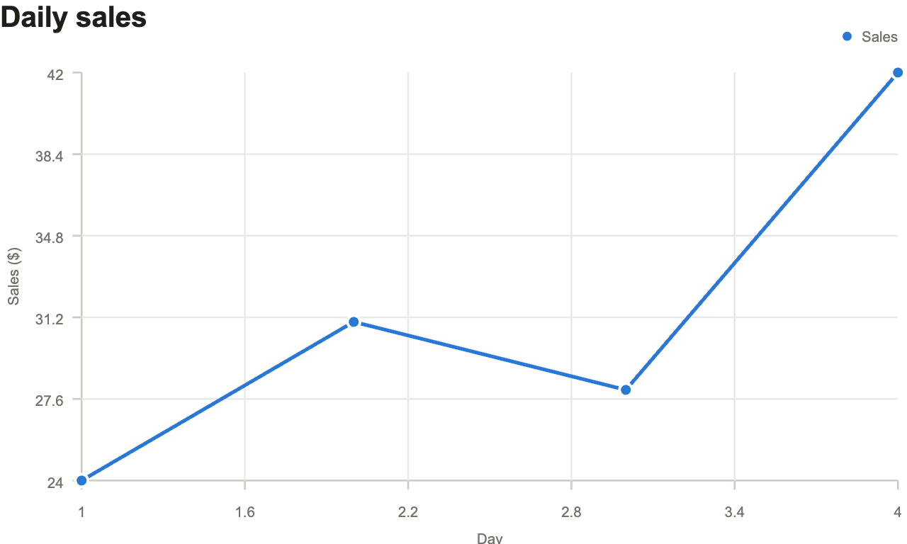
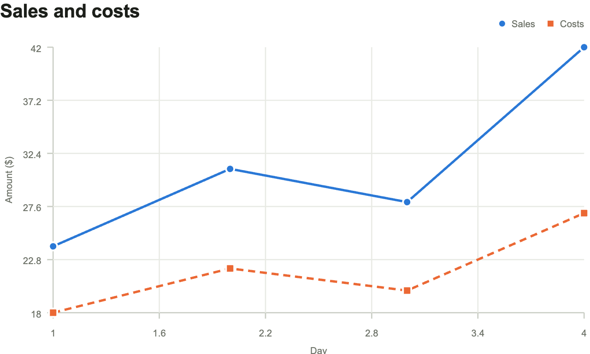
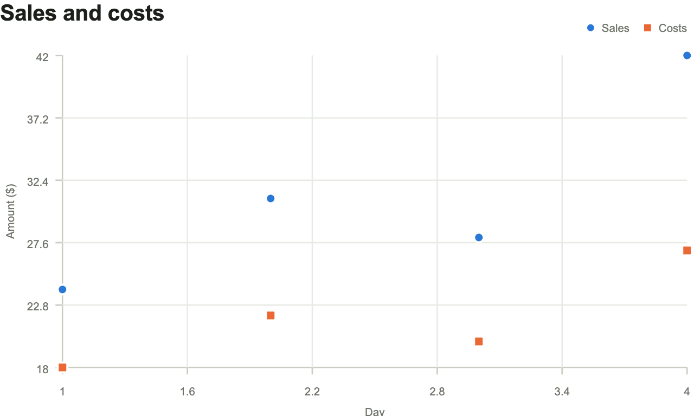

# Getting started

This example plots daily sales, adds costs as a second series, and then switches to a scatter plot. It assumes `createChart` is already available in the script.

## Create a chart

Let's say we want to plot sales figures for four days:

| Day | Sales ($) |
| --- | --------- |
| 1   | 24        |
| 2   | 31        |
| 3   | 28        |
| 4   | 42        |

Add a container to the page, within which the chart will be placed:

```html
<div id="sales-chart" style="width: 100%; max-width: 640px"></div>
```

The chart will plot sales for four days, with the day on the horizontal axis and sales in dollars on the vertical axis. Pass that data and the chart's labels to `createChart`:

```js
const options = {
	type: 'line',
	labels: {
		title: 'Daily sales',
		subtitle: '',
		x_axis_label: 'Day',
		y_axis_label: 'Sales ($)',
	},
	// A series is one dataset on the chart. This one is called "Sales".
	series: [{ name: 'Sales', color: '#2a78d6' }],
	columns: {
		length: 4, // Four observations, one for each day.
		x: Float64Array.of(1, 2, 3, 4), // Days on the horizontal axis.
		// One Y array for our one series, with a sales figure for each day.
		ys: [
			Float64Array.of(24, 31, 28, 42), // Day 1: $24, day 2: $31, and so on.
		],
	},
}

const chart = createChart(document.getElementById('sales-chart'), options)
```

<chart-example data-type="line" role="figure" aria-label="Daily sales: 24, 31, 28, and 42 dollars on days 1 through 4.">



</chart-example>

## Add a second series

To compare sales with costs, add a second series using the same days:

| Day | Sales ($) | Costs ($) |
| --- | --------- | --------- |
| 1   | 24        | 18        |
| 2   | 31        | 22        |
| 3   | 28        | 20        |
| 4   | 42        | 27        |

Both series share the X values. Each needs its own Y array and a corresponding entry in `series`. Keep them in the same order: sales first, then costs.

```js
const comparisonOptions = {
	...options,
	labels: { ...options.labels, title: 'Sales and costs', y_axis_label: 'Amount ($)' },
	series: [
		{ name: 'Sales', color: '#2a78d6' },
		{ name: 'Costs', color: '#eb6834', marker: 'square', dash: '6 4' },
	],
	columns: {
		length: 4,
		x: Float64Array.of(1, 2, 3, 4), // Shared days.
		ys: [
			Float64Array.of(24, 31, 28, 42), // Sales.
			Float64Array.of(18, 22, 20, 27), // Costs.
		],
	},
}

chart.update(comparisonOptions)
```

<chart-example data-example="comparison" data-type="line" role="figure" aria-label="Sales and costs by day: sales of 24, 31, 28, and 42 dollars; costs of 18, 22, 20, and 27 dollars.">



</chart-example>

`update` redraws the existing chart with the supplied configuration. Here it replaces the dataset and updates the title and vertical-axis label to describe both series. The chart type and other settings are retained by including `options` in the new configuration.

## Change the chart type

Use the same two-series configuration to switch to a scatter plot:

```js
chart.update({ ...comparisonOptions, type: 'scatter' })
```

<chart-example data-example="comparison" data-type="scatter" role="figure" aria-label="Sales and costs as a scatter plot: sales of 24, 31, 28, and 42 dollars; costs of 18, 22, 20, and 27 dollars.">



</chart-example>

Each update takes a complete configuration, including `series` and `columns`. Omitted optional settings use their defaults; they do not retain values from the previous update.

## Remove the chart

Call `destroy` when the chart is no longer needed, such as when its containing view is removed:

```js
chart.destroy()
```

This removes the chart and releases its event listeners and resize observer.

See the [API reference](api.md) for series styles, missing values, trend lines, and warning and error handling.
